# Towneers — free social multiplayer life sim in your browser

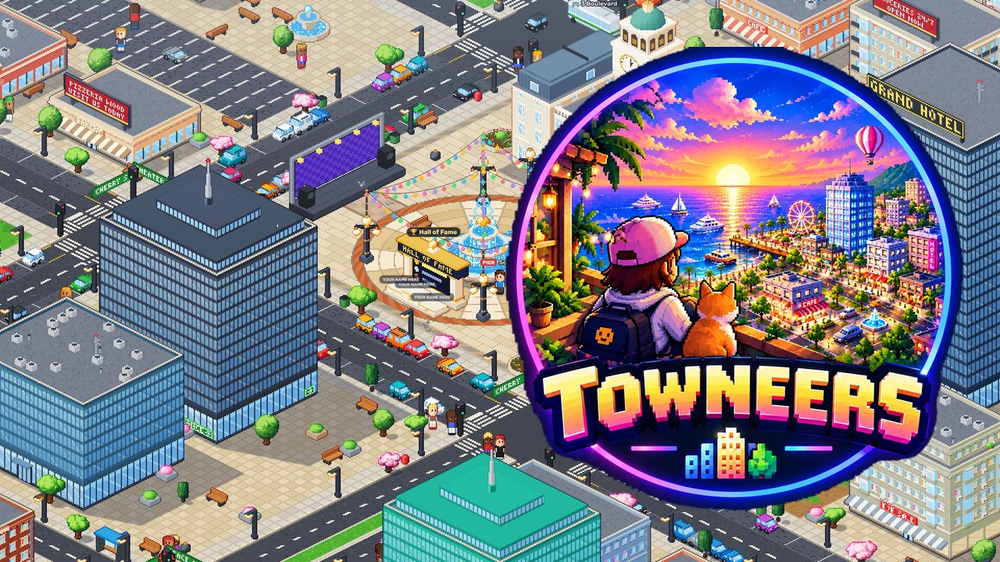

**Towneers** is a free-to-play social multiplayer online game and life simulator that runs in the browser on desktop
and mobile — no download, no install. Everyone shares one isometric pixel city: players chat, open cafés and shops,
hire each other for shifts, trade in a player-run market with real prices, run team factories, farm, fish, play
football and design their own houses tile by tile.

▶ **Play free:** https://towneers.world/r/github?utm_campaign=presskit&utm_content=readme

| | |
|---|---|
| Genre | Social life sim · browser MMO · sandbox · player economy |
| Platforms | Web browser (desktop, Android, iOS) — no download |
| Price | Free to play (optional cosmetic shop) |
| Languages | English, Spanish, German, Ukrainian, Russian |
| Status | Open alpha, weekly updates |
| Developer | Towneers (independent, solo) |
| Website | https://towneers.world |

## What makes Towneers different

- **Other players matter.** The city sells the basics and buys at a floor price; the best deals happen between people.
  Café owners post buy orders for your fish, paid from their own cash register.
- **Work for each other.** Owners hire players for shifts at the till and rate them 👍/👎 — that becomes your reputation.
- **A market with real prices.** The Trading House shows what players actually pay: the median of the last week's deals.
- **Build something together.** Teams share a treasury, rent a factory hall and install machines by hand.
- **Your own place.** Buy a plot with your name on the plaque and design a house tile by tile: floors, towers,
  balconies, a yard with a pool and a garden.
- **Live a little.** Fishing, farming, crafting, football matches, a funfair on Sunset Pier, evening events with
  fireworks, the Hall of Fame and 700+ NPC residents filling the streets.

## Screenshots

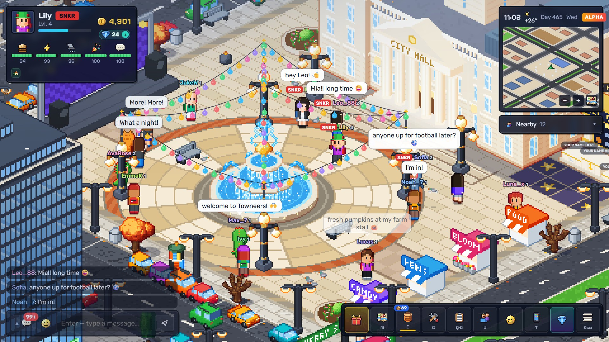
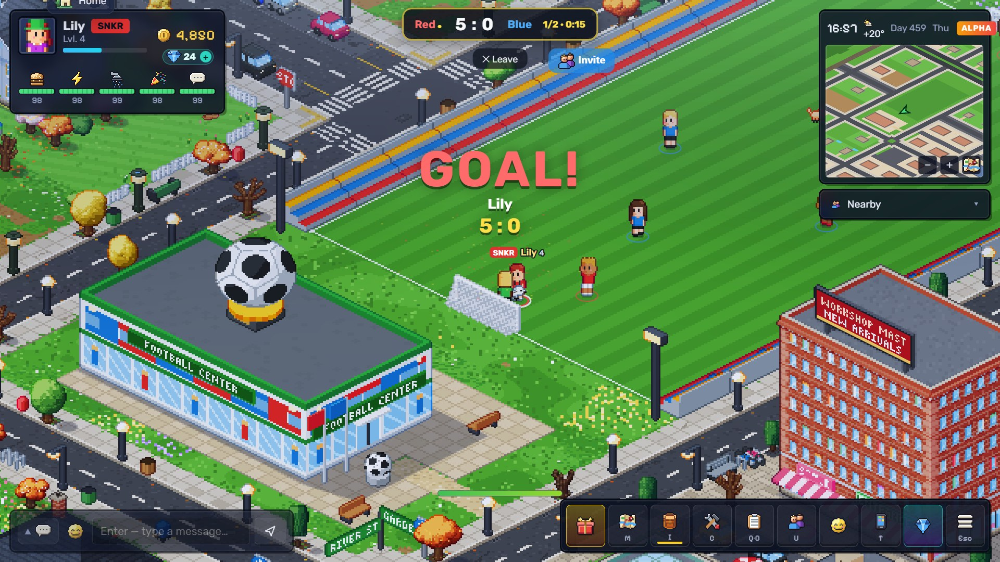
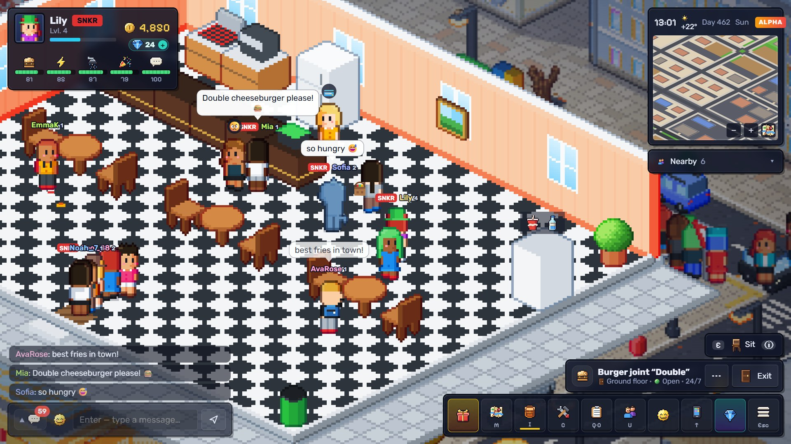
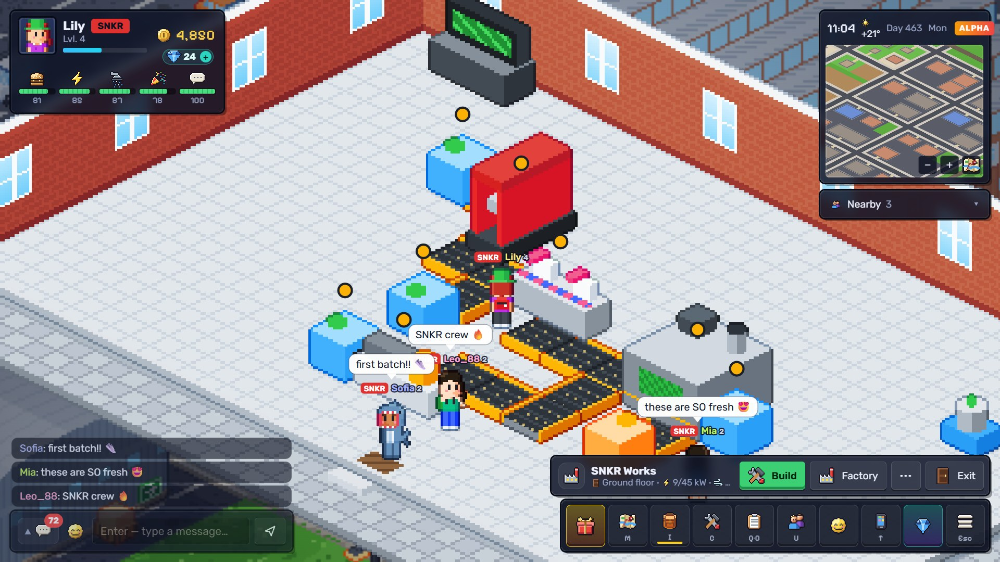
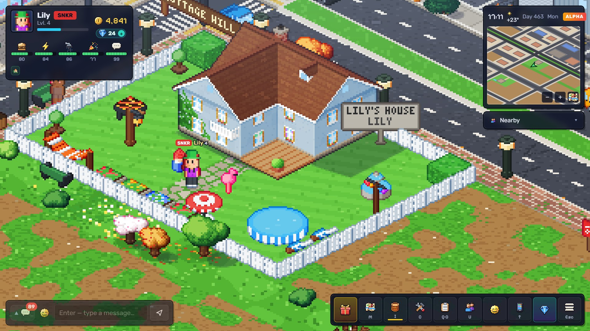
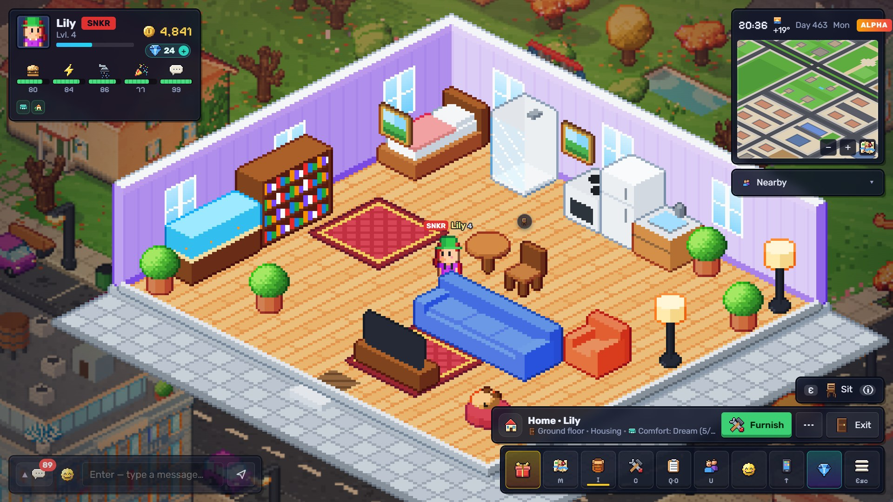
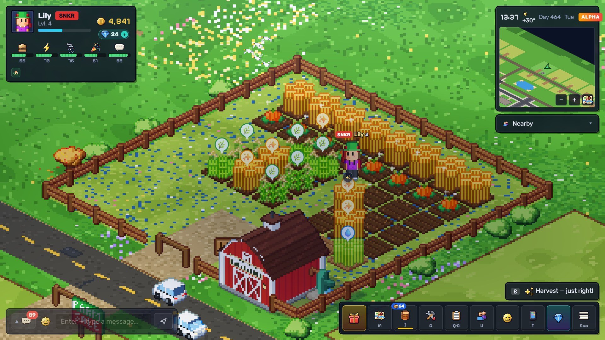
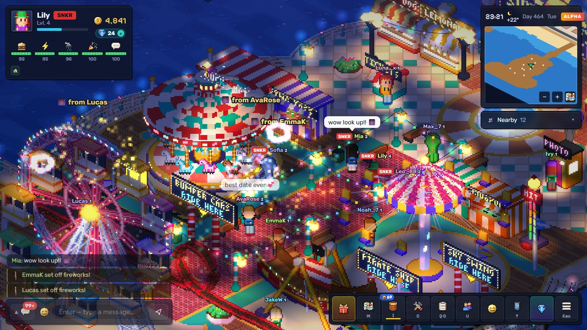
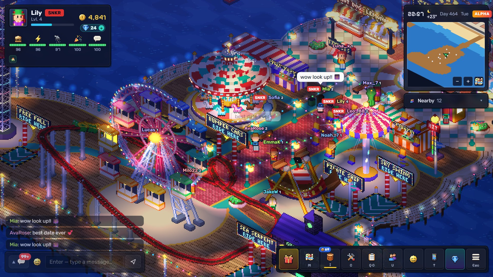
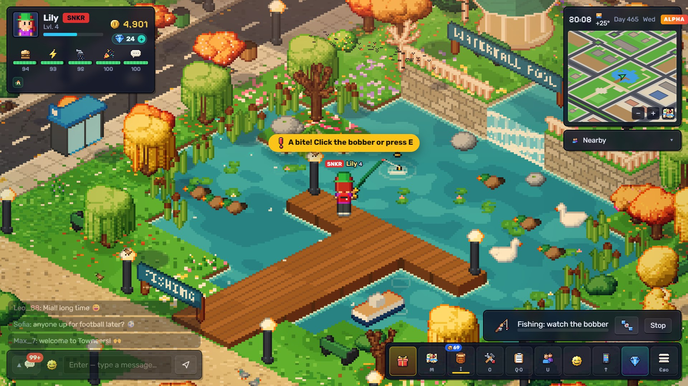

## FAQ

**What is Towneers?** A free social multiplayer online life sim in the browser where players share one pixel city.

**Is it free?** Yes, free to play in any modern browser. An optional shop sells cosmetics and conveniences.

**Do I need to download anything?** No. It runs in the browser on a computer or a phone; you can start as a guest.

**Is it single-player?** No — it's a shared online world with real players and 700+ NPC residents.

**What can you do?** Fish, farm, craft, open a café or shop, work shifts for other players, trade in the
player-run Trading House, join a team and run a factory, build your own house, play football, visit the funfair.

**Is it finished?** It's an open alpha with weekly updates. Feedback goes straight to the developer from the in-game menu.

## Links

- Website: https://towneers.world
- itch.io: https://towneers.itch.io/towneers
- Game Jolt: https://gamejolt.com/games/towneers/1122767
- Product Hunt: https://www.producthunt.com/products/towneers
- Devlog: https://towneers.hashnode.dev
- Medium: https://medium.com/@projectordi
- DEV: https://dev.to/towneers

## Press

Screenshots and logos in this repository may be used for coverage of Towneers.
Contact: projectordi@gmail.com
